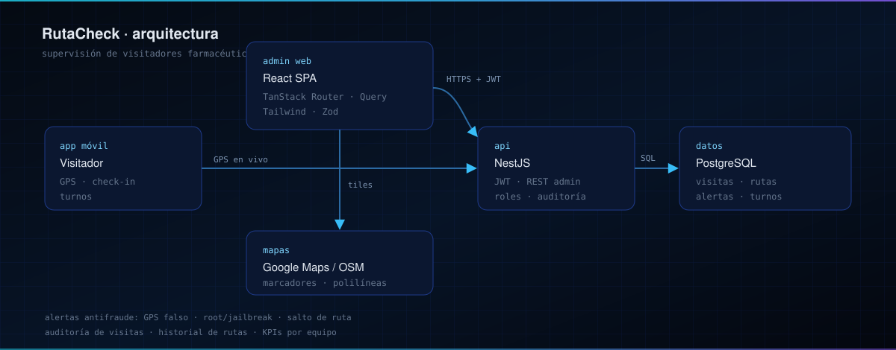

  
  <h1>RutaCheck</h1>
  
<b>Supervisión de visitadores farmacéuticos</b> KPIs, GPS en vivo, auditoría de visitas y alertas antifraude.

  
  
  
  
  
  

> **Caso de estudio.** El código es privado; este repositorio documenta el producto, la arquitectura y las decisiones técnicas. No incluye código fuente ni datos de clientes.

## El problema

Las cadenas farmacéuticas supervisan visitadores de campo con planillas y reportes manuales: no hay visibilidad del recorrido real, ni forma de detectar visitas inventadas o suplantación de ubicación, y la auditoría llega días después.

## La solución

Un panel de administración que consume la API de RutaCheck y convierte la operación de campo en información accionable:

| Módulo | Qué resuelve |
|---|---|
| **Dashboard** | KPIs con tendencia, visitas vs. ventas, motivos y ranking del equipo |
| **Monitoreo** | Mapa en vivo de visitadores en turno e historial de rutas con polilíneas |
| **Visitas** | Auditoría del equipo con detalle forense por visita |
| **Alertas** | Registro antifraude: GPS falso, root/jailbreak, saltos de ruta |
| **Turnos** | Turnos abiertos, olvidados y cierre manual |
| **Usuarios y clientes** | Gestión de accesos e historial de visitas por cliente |

## Arquitectura

- **Panel web (React SPA)** — React + TypeScript, ruteo por archivos con **TanStack Router**, estado de servidor con **TanStack Query**, estilos con **Tailwind** y validación de formularios con **Zod**.
- **API (NestJS)** — endpoints administrativos protegidos con **JWT** y control de roles; registra la auditoría de cada acción.
- **Datos (PostgreSQL)** — visitas, rutas, alertas, turnos y catálogos.
- **Mapas** — Google Maps con marcadores avanzados; si falta la API key, cae a **Leaflet + OpenStreetMap** sin romper la pantalla.

## Decisiones técnicas

- **Ruteo tipado y cache por consulta**: TanStack Router + Query evitan estado global para datos del servidor y permiten precarga por ruta.
- **Validación en el borde**: los formularios y las respuestas se validan con Zod antes de tocar la UI.
- **Mapa con degradación elegante**: Google Maps es opcional; el fallback a OpenStreetMap mantiene el monitoreo operativo.
- **Detalle forense**: las pantallas de visitas y alertas usan un panel de detalle fijo para comparar eventos sin perder contexto.
- **Errores explícitos**: sesión no autorizada, visitante sin permisos y 403 de API tienen rutas dedicadas (`/unauthorized`, 404).

## Estado

Producto en desarrollo activo. El repositorio de código es privado por tratarse de software para clientes; puedo compartir una demo o capturas bajo solicitud.

---

Parte de mi portafolio — <a href="https://github.com/Mau6987">github.com/Mau6987</a>

